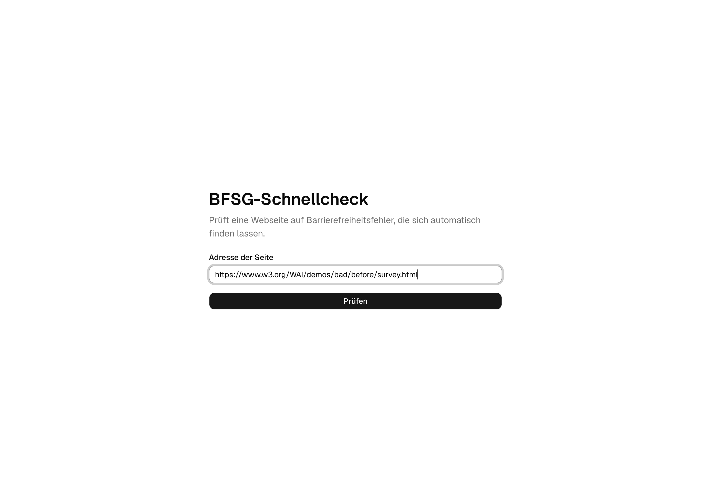
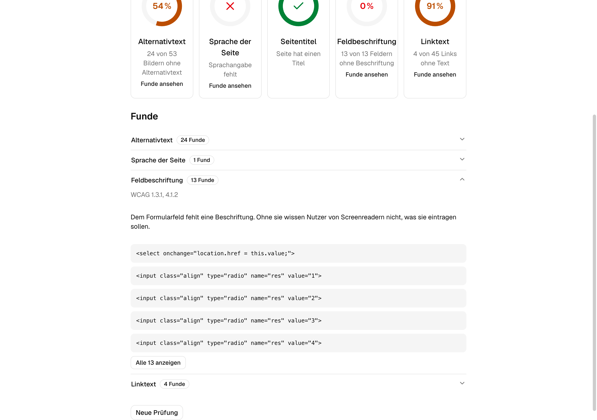
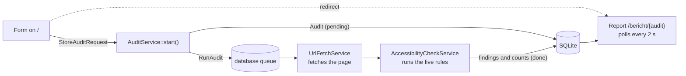

<h1 align="center">BFSG-Schnellcheck</h1>

<p align="center">
  Checks a web page for accessibility errors that can be found automatically<br />
  and turns the result into a report you can share by link.
</p>

<p align="center">
  <a href="#what-it-checks">What it checks</a> ·
  <a href="#how-an-audit-runs">How it works</a> ·
  <a href="#getting-started">Getting started</a> ·
  <a href="#how-this-project-is-built">How it's built</a>
</p>

<p align="center">
  
</p>

<br />

## Why

Since 28 June 2025 the German Barrierefreiheitsstärkungsgesetz (BFSG) requires many online shops and services to be accessible. Many small businesses don't know where their site stands. The Schnellcheck gives a first answer in a few seconds: enter a URL, wait for the audit, read which basic rules the page breaks and where.

It is deliberately small. Five rules, one page, no login. Each rule is easy to explain and easy to test.

## What it checks

| Rule              | What fails                                                                                                                        | WCAG         |
| ----------------- | --------------------------------------------------------------------------------------------------------------------------------- | ------------ |
| Alternativtext    | An image without an `alt` attribute. Images with `aria-hidden="true"`, `role="presentation"` or `role="none"` are skipped.        | 1.1.1        |
| Sprache der Seite | `<html>` without a `lang` attribute, or with an empty one.                                                                        | 3.1.1        |
| Seitentitel       | A missing or empty `<title>`.                                                                                                     | 2.4.2        |
| Feldbeschriftung  | An `input`, `select` or `textarea` without a `<label>`, `aria-label` or `aria-labelledby`. Hidden inputs and buttons are skipped. | 1.3.1, 4.1.2 |
| Linktext          | A link (`a[href]`) without text, `aria-label`, `aria-labelledby`, `title`, or an image or icon with a name.                       | 2.4.4, 4.1.2 |

Above the findings, one ring per rule shows the share of checked elements that pass, with a sentence such as "4 von 45 Links ohne Text". Language and title exist once per page, so their ring shows a check or a cross. There is no overall score on purpose: five rules can't tell how accessible a site is.

<table>
  <tr>
    <td width="50%"></td>
    <td width="50%"></td>
  </tr>
  <tr>
    <td align="center">Enter the address of a page</td>
    <td align="center">Every finding shows the HTML that caused it</td>
  </tr>
</table>

To try it, use the W3C's intentionally broken [Before and After Demonstration](https://www.w3.org/WAI/demos/bad/before/survey.html) and compare it with the [repaired version](https://www.w3.org/WAI/demos/bad/after/survey.html).

## How an audit runs



1. `StoreAuditRequest` accepts only `http` and `https` addresses. Each IP address can start five audits per minute.
2. `AuditService::start()` stores an `Audit` with a ULID as key, so report links can't be guessed, and queues `RunAudit`.
3. The job fetches the page, parses it with PHP 8.4's `Dom\HTMLDocument` and stores the findings together with the number of checked elements per rule. At most 150 findings per rule are stored; the full count is kept separately.
4. The report polls with Inertia's `usePoll` until the audit is done or failed.

### Fetching external pages safely

The app loads any URL a visitor types in, so `UrlFetchService` guards against server-side request forgery:

- Only `http` and `https`, and only hosts whose DNS answers are **all** public addresses.
- The checked IP is pinned for the connection with `CURLOPT_RESOLVE`, so the DNS answer can't change between check and request.
- Laravel's HTTP client follows at most five redirects. A Guzzle middleware added with `Http::withMiddleware()` checks and pins every hop again.
- The request ends after 10 seconds or 5 MB. The page is requested uncompressed, so the limit holds for the HTML itself.
- Only `text/html` and `application/xhtml+xml` responses are checked.

### What it can't do

Automated checks find only some of the problems. The Schnellcheck reads the HTML the server sends for one page, without running JavaScript, so content rendered in the browser is not checked. The report is not a legal assessment.

## Getting started

You need PHP 8.4 or later, Composer and Node 22.

```bash
git clone https://github.com/Aldr0n/bfsg-schnellcheck.git
cd bfsg-schnellcheck
composer setup
composer dev
```

`composer setup` installs the dependencies, creates `.env`, an app key and the migrated SQLite database, and builds the frontend. `composer dev` starts the web server, the queue worker, a log tail (Pail) and Vite. The app then runs at http://localhost:8000.

### Checks

```bash
composer ci:check
```

This is exactly what CI runs: lint and formatting with Vite+, TypeScript, Pint, PHPStan on level 7 and the Pest feature tests. Stray HTTP requests fail the test, and every test that resolves a host mocks the DNS resolver, so the tests never reach the network.

## Stack

- [Laravel 13](https://laravel.com) on PHP 8.4, with SQLite and the `database` queue
- [Inertia](https://inertiajs.com) and [React 19](https://react.dev) with TypeScript, from the Laravel React Starter Kit
- [Tailwind CSS 4](https://tailwindcss.com) and [shadcn/ui](https://ui.shadcn.com)
- [Wayfinder](https://github.com/laravel/wayfinder) for typed routes, [Pest](https://pestphp.com) and [PHPStan](https://phpstan.org) with Larastan

## How this project is built

Every feature and fix starts as an [issue](https://github.com/Aldr0n/bfsg-schnellcheck/issues?q=is%3Aissue) with context, tasks and a definition of done, and lands as a pull request with Conventional Commits and a merge commit.

The code follows the rules in [`CLAUDE.md`](CLAUDE.md): Laravel first, thin controllers, services and repositories, backed enums, feature tests for business logic and no tests of framework behavior. The project is built with Claude Code. One agent plans, subagents implement, and before a pull request one subagent reviews the diff for simplicity and another checks only the names.
