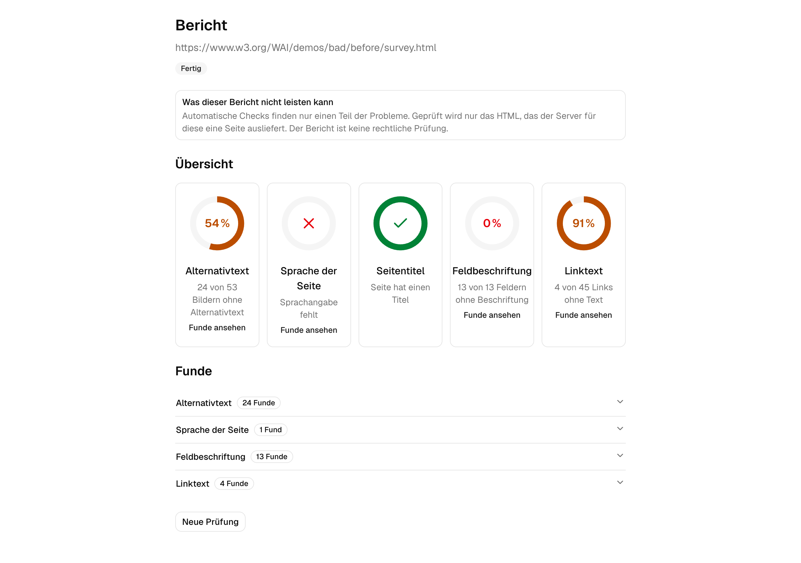
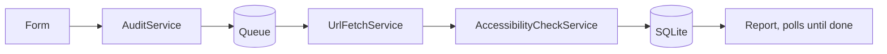

<h1 align="center">BFSG-Schnellcheck</h1>

<p align="center">
  Checks a web page for accessibility errors that can be found automatically<br />
  and turns the result into a report you can share by link.
</p>

<p align="center">
  
</p>

Since 28 June 2025 the German Barrierefreiheitsstärkungsgesetz (BFSG) requires many online shops to be accessible. The Schnellcheck gives a first answer in a few seconds, deliberately small: five rules, one page, no login.

## What it checks

| Rule              | What fails                                                                     | WCAG         |
| ----------------- | ------------------------------------------------------------------------------ | ------------ |
| Alternativtext    | An image without an `alt` attribute                                            | 1.1.1        |
| Sprache der Seite | `<html>` without a `lang` attribute                                            | 3.1.1        |
| Seitentitel       | A missing or empty `<title>`                                                   | 2.4.2        |
| Feldbeschriftung  | A form field without a `<label>`, `aria-label` or `aria-labelledby`            | 1.3.1, 4.1.2 |
| Linktext          | A link without text, `aria-label`, `aria-labelledby`, `title` or a named image | 2.4.4, 4.1.2 |

To try it, check the W3C's intentionally broken [demo page](https://www.w3.org/WAI/demos/bad/before/survey.html).

## How it works



The app fetches any URL a visitor enters, so `UrlFetchService` guards against server-side request forgery:

- Only `http` and `https` hosts whose DNS answers are all public addresses.
- The checked IP is pinned for every redirect hop by a Guzzle middleware.
- At most five redirects, 10 seconds and 5 MB of uncompressed HTML.

## Getting started

You need PHP 8.4, Composer and Node 22.

```bash
composer setup     # dependencies, .env, SQLite database, frontend build
composer dev       # server, queue worker and Vite on http://localhost:8000
composer ci:check  # lint, types, Pint, PHPStan and Pest, exactly as in CI
```

## Architecture decisions

- **Queue job** instead of a synchronous fetch. The report polls with Inertia's `usePoll`.
- **`Dom\HTMLDocument`** from PHP 8.4 instead of a headless browser: a real HTML5 parser, no extra packages like a headless Chrome.
- **Guzzle middleware** for the SSRF guard. Laravel's HTTP client follows redirects, then a middleware checks every hop.
- **ULIDs** instead of a login, so report links can be shared, without enabling guessing of id`s.
- **Services, repositories and backed enums** behind thin controllers.
- **No overall score**, because five rules can't reflect a whole sites BFSG score.

## AI workflow

No vibe coding here. When AI is used, it works within fixed rules, following established agentic coding patterns (→ [www.anthropic.com](https://www.anthropic.com/engineering/building-effective-agents)). Every change is specified, reviewed and merged by hand.

- **Spec first:** every change is a GitHub issue with tasks and a definition of done.
- **Context engineering:** [`CLAUDE.md`](CLAUDE.md) gives every agent the coding rules.
- **Orchestrator–workers:** one agent plans, subagents implement.
- **Human in the loop:** every pull request is reviewed and merged by hand.

## Quality assurance

- Pest feature tests for business logic.
- PHPStan level 7, Pint, Vite+ and TypeScript in `composer ci:check` and CI.
- A browser check of every visible change.

## Known limits

- Only the HTML of one page, without JavaScript. This tool does not represent a legal assessment.
- Five rules and known false positives: `aria-hidden` containers, hidden fields, fields labeled only by `title`.
- Pages in a non-UTF-8 charset can fail when a finding contains an umlaut.
- Not deployed. SQLite and one queue worker.

## Built with

Laravel 13, Inertia, React 19, Tailwind CSS 4 and shadcn/ui.
